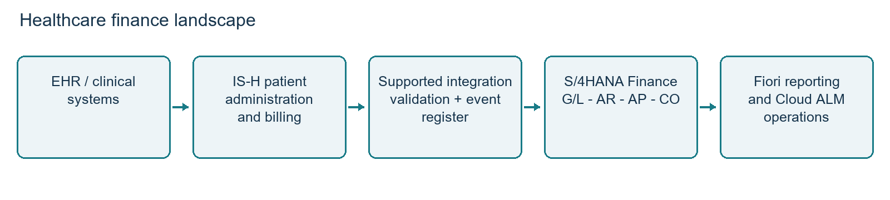
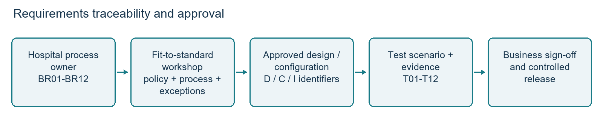
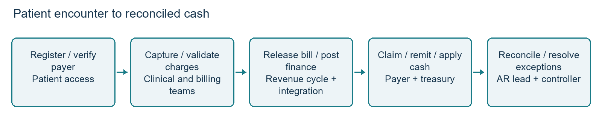
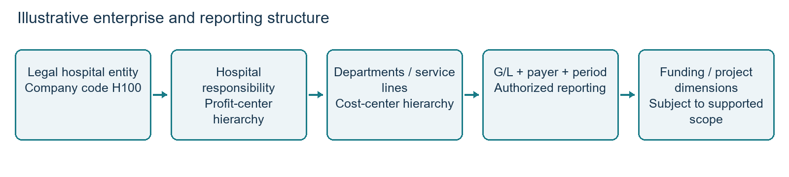
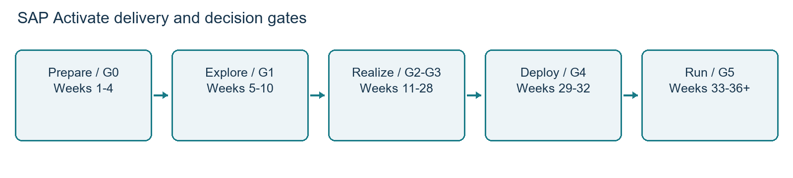

# Healthcare implementation blueprint

## 1. Project profile and business value

Client / industry: California Department Agency | Public Sector. The supplied engagement establishes the portfolio experience; the following implementation blueprint applies that finance capability to a public healthcare provider. Healthcare design examples, account numbers, schedules and acceptance thresholds are proposed planning parameters, not additional claims about the completed engagement.

Role: Lead SAP FICO Functional Solution Architect. Ecosystem: SAP S/4HANA Finance Cloud FI/CO, Universal Journal (ACDOCA), SAP Fiori, SAP Solution Manager and SAP Cloud ALM. Delivery framework: SAP Activate, including Explore, Realize, Deploy and Run, preceded by scope confirmation and readiness preparation.

Portfolio achievements: Led functional architecture and blueprinting workshops for a Greenfield S/4HANA Finance migration, transforming disparate legacy accounting structures into a single source of truth in the Universal Journal. Built and configured enterprise global templates for General Ledger, Accounts Payable, Accounts Receivable and Cost Center Accounting.

Reported business value: Shortened corporate month-end close by two business days. For a healthcare rollout, establish the baseline from three comparable closes and measure business days from period end to controller-approved reporting. Track late interfaces, unresolved reconciliations, manual journals and reopened periods to demonstrate that faster close preserves control quality.

## 2. Healthcare scope and architecture decision

The reference scenario is a hospital network with inpatient, outpatient, emergency, laboratory, pharmacy and shared-service finance operations. SAP Patient Management (IS-H) manages patient administration and patient billing where supported; an EHR manages clinical records. S/4HANA is the finance and controlling target. Patient billing is not assumed to be a native Public Edition function.

Architecture gate G0: Confirm the exact IS-H release, enhancement/support package, country version, supported finance integration, S/4HANA edition/release, hosting and licensing with SAP and the implementation partner. Review the SAP for Healthcare integration configuration guide and release-specific compatibility information. Obtain a written supportability decision before fixing the target landscape. A generic custom API does not establish product compatibility.

Preferred planning pattern: retain supported IS-H patient administration/billing and integrate a separate S/4HANA finance target using the supported integration pattern for the selected releases. If that combination cannot meet requirements, evaluate a supported private-cloud finance option or replacement patient accounting platform. Do not assume IS-H can be installed inside S/4HANA Cloud Public Edition. This gate can change scope, budget and timeline.

Boundary: All detailed workflows in this blueprint serve healthcare. Public-sector grants and restricted funds are included only where relevant to hospital funding. Detailed clinical care pathways, medical device control and insurer adjudication engines are outside finance scope; their financial handoffs are included.

System ownership: IS-H owns encounters, charge detail and bill versions; EHR owns clinical observations; payer/clearinghouse owns external claim responses; S/4 owns accepted accounting documents, AP, cash, assets and management accounting. Define whether patient receivables remain detailed in IS-H or are represented as individual finance open items. Never maintain two independent authoritative receivables ledgers.

## 3. Business requirements

Run fit-to-standard workshops with revenue cycle, admitting, patient access, coding, nursing operations, pharmacy, procurement, treasury, finance, audit, security and IT operations. Capture current process, volume/peak load, pain point, policy, reporting need, source owner, exception path and acceptance evidence. Separate mandatory requirements from local preferences.

| ID | Healthcare requirement and business rule | Owner | Acceptance evidence |
| --- | --- | --- | --- |

| BR01 | Trace every posted patient bill to encounter, payer and bill version using restricted references | Revenue cycle | Original, reversal and rebill trace without duplicate revenue |

| BR02 | Split insurer and patient responsibility; retain payer hierarchy and settlement status | Patient accounting | Primary/secondary/self-pay scenario reconciles end to end |

| BR03 | Recognize revenue and contractual adjustments under approved accounting policy | Controller | Gross charge, adjustment and net revenue reconcile by service line |

| BR04 | Match remittance, cash and deductions; route denials to work queues | Treasury / revenue cycle | Partial payment and denial remain visible without premature write-off |

| BR05 | Control clinical supplies procurement, receipt, invoice and returns | Supply chain | Three-way match blocks price/quantity exceptions |

| BR06 | Report cost by hospital, department, service line and funding source | Cost accounting | Allocations reconcile to sender costs and approved drivers |

| BR07 | Close on time with reconciled patient AR, AP, bank, assets and inventory | Controller | All close controls signed; target two fewer business days |

| BR08 | Limit patient data and enforce approved access, retention and audit controls | Security / privacy | Role tests, log review and masked nonproduction datasets approved |

| BR09 | Recover finance interfaces without losing or duplicating transactions | Integration operations | Restart, duplicate, outage and replay tests pass |

| BR10 | Trace capital equipment from purchase to in-service date and depreciation | Fixed asset lead | Equipment acquisition and asset roll-forward reconcile |

| BR11 | Separate restricted healthcare funding where required | Grants finance | Fund/project reporting ties to G/L and approved funding rules |

| BR12 | Maintain essential hospital operations during finance cutover | Hospital operations | Downtime capture and backlog replay rehearsal accepted |

Requirements governance: Record BR ID, process ID, priority, source policy, design decision, configuration object, integration mapping, test case and approval in Cloud ALM or a linked controlled register. Example: BR02 -> P01 -> payer split design D02 -> BP/reconciliation setup C04 -> interface I02 -> test T02 -> revenue-cycle sign-off. Rejected gaps need rationale; accepted gaps need cost and owner.

## 4. Business processes

### 4.1 P01: Patient encounter to collected cash

Patient access verifies identity, eligibility and payer order before admission or outpatient registration. IS-H creates the case/encounter; clinical systems capture authorized services. Coding and billing validate completeness, tariffs, payer rules and medical necessity handoffs before bill release. Financial posting starts only at the approved accounting event, not merely at registration.

Billing calculates payer/self-pay shares and sends the supported accounting handoff. Finance validates company code, posting date, currency, tax treatment where applicable, customer mapping, service-line account and balancing. Failed messages enter a monitored exception queue. Revenue cycle submits claims through its clearinghouse; claim submission and finance posting are separately tracked events.

Payer remittance creates matched cash applications or controlled unapplied cash. Denials are classified as administrative correction, appeal, contractual adjustment, credit loss or patient responsibility under approved policy. Rebilling reverses or adjusts the original version and creates a linked new bill; it must not create a second unlinked revenue posting. Refunds require overpayment validation and independent approval.

### 4.2 P02: Clinical procure to pay

Department requests clinical supplies with cost center or project. Procurement checks contract, supplier approval and budget where configured; an authorized buyer releases the purchase order. Stores record receipt, lot/batch and expiry in the relevant supply system where required. Invoice matching compares PO, receipt and invoice. Blocked invoices go to an owner; treasury pays only released items after proposal review and bank authorization. Consignment, implant usage, controlled stock and pharmacy systems need explicit ownership and financial reconciliation.

### 4.3 P03: Healthcare record to report

Daily, reconcile patient billing batches and finance documents, bank clearing, AP exceptions and interface aging. At period end, freeze the agreed charge and accounting cutoff, accrue unbilled services under policy, reconcile patient AR and allowance balances, post inventory and payroll feeds, settle assets and allocate shared costs. Controller reviews trial balance, statement mappings and service-line results before period lock. Late charges use the approved subsequent-period or adjustment-period policy.

### 4.4 P04: Cost and equipment lifecycle

Create cost centers for emergency, wards, operating rooms, imaging, pharmacy and shared services. Validate hospital/profit-center assignments and effective dates. Allocate housekeeping by approved area, IT by supported users and facilities by area or metered consumption. Review whether activity-based service costing needs additional functionality before promising patient-level profitability. For MRI or other equipment, distinguish capital acquisition, construction in progress, commissioning, depreciation and maintenance expense.

## 5. Design and chart of accounts

### 5.1 Enterprise and ledger model

Illustrative structure: company code H100 for the legal hospital entity; additional company codes only for distinct legal/reporting requirements. Use hospital profit centers and department cost centers with effective-dated hierarchies. A controlling area and operating chart must be consistent with the chosen edition's supported design. Define leading ledger, accounting principles, fiscal calendar, currencies, exchange-rate governance and reporting hierarchies before transactions are loaded.

Public-sector accounting basis, fund reporting, grants, budget control and statutory statements require separate fit assessment. Do not equate a profit center with a legally required fund. Add supported dimensions or products only after confirming scope and reconciliation. Define intercompany services and balancing rules when several legal entities share clinical services.

### 5.2 Illustrative healthcare chart of accounts

The HCOA below is a proposed logical mapping, not SAP-delivered account content or a claim of statutory compliance. For Public Edition, map these logical accounts to the supported delivered operating chart and permitted adaptations. Finance approves financial statement versions, account classification, posting attributes and legacy crosswalk before build.

| Account | Description | Design / posting control |
| --- | --- | --- |

| 100100 | Operating bank | Bank account and statement clearing design |

| 100110 | Incoming cash clearing | Open items; bank receipt matching |

| 110100 | Insurer receivables | Customer reconciliation; subledger postings only |

| 110200 | Patient self-pay receivables | Separate reconciliation if supported design requires |

| 110900 | Credit loss allowance | Controlled estimate; reconcile to allowance schedule |

| 120100 | Clinical supply inventory | Valuation/account determination; controlled postings |

| 130100 | Medical equipment cost | Asset reconciliation; asset-origin postings |

| 139100 | Accumulated depreciation | Asset reconciliation; depreciation-origin postings |

| 150100 | Unbilled service accrual asset | Reversing accrual under approved policy |

| 200100 | Trade payables | Supplier reconciliation; subledger postings only |

| 210100 | Goods receipt / invoice receipt | Procurement clearing and aging control |

| 220100 | Payroll accrual | Payroll interface reconciliation |

| 230100 | Patient credit / refund liability | Classify and reclassify under approved policy |

| 240100 | Deferred grant income | Funding terms determine recognition |

| 300100 | Net position / accumulated result | Reporting basis and legal entity approval |

| 400100 | Inpatient gross patient revenue | Department/service-line derivation |

| 400200 | Outpatient gross patient revenue | Department/service-line derivation |

| 409100 | Contractual revenue adjustments | Contra-revenue; reason-code controlled |

| 500100 | Clinical supplies expense | Primary cost G/L; department assignment |

| 510100 | Clinical payroll expense | Payroll source, cost center and period validation |

| 520100 | Shared clinical services expense | Allocation sender and receiver validation |

| 530100 | Depreciation expense | Asset class and cost-center derivation |

| 540100 | Credit loss expense | Separate from contractual adjustments |

| 900100 | Migration offset clearing | Temporary, restricted; zero after accepted migration |

Account setup checklist: define balance-sheet/P&L category, reconciliation indicator, open-item management where permitted and required, line-item reporting, tax category, currency restrictions, field controls, cost-element category where applicable, retained earnings assignment and posting authorization. Validate the settings against release capabilities; changes to open-item or reconciliation settings after posting can require remediation.

### 5.3 Healthcare master data and accounting policies

BP design separates payer, patient/self-pay, supplier and employee-related roles. Keep clinical identifiers out of general journal text. Store a restricted reference/token for traceability; clinical diagnosis and treatment detail remain in the clinical/patient system unless explicitly justified. Set payment terms, dunning blocks, collection restrictions, dispute reasons and refund approvals according to provider policy and payer agreements.

Define billed versus unbilled revenue, contractual adjustments, credit loss estimates, charity care, deposits, credit balances, capitation and grants as separate decisions. The illustrative journal chapter assumes fee-for-service and gross charge/contra-revenue presentation. Finance must approve whether actual external reporting uses this presentation. Capitation and bundled payments need their own recognition rules and test cases.

### 5.4 Controls, reporting and security

Separate supplier maintenance, invoice entry, payment approval and bank release; separate patient adjustment entry from write-off/refund approval. Restrict company codes and hospital reporting by role. Emergency access is time limited, logged and reviewed. Reports include patient AR aging by payer/responsibility, unbilled services, denial aging, net revenue bridge, GR/IR aging, cash clearing, departmental actuals versus budget and equipment roll-forward.

## 6. Configuration implementation workbook

Use approved configuration activities available in the selected edition. Public Edition uses its supported configuration environment and released extensibility; Private Edition uses the applicable customizing and transport approach. Transaction codes and configuration activity IDs must be added from the confirmed release rather than assumed universal.

| ID / build sequence | Setup decisions and configuration | Verification / evidence |
| --- | --- | --- |

| C01 Foundation | Confirm country, scope, organizational units, calendars and currencies before dependent setup | Signed enterprise design; structure consistency check |

| C02 G/L | Chart mapping, ledgers, accounting principles, document types, number ranges, posting periods and field controls | Balanced journal, reversal, closed-period rejection, statement mapping |

| C03 CO | Cost/profit-center hierarchies, validity, primary/secondary cost categories, allocation cycles and drivers | Department derivation; sender/receiver allocation tie-out |

| C04 AR / BP | BP roles, payer/customer mapping, reconciliation accounts, payment terms, reason codes and dunning policy | Insurer/self-pay split; dispute block; controlled adjustment |

| C05 AP | Supplier roles, terms, tolerance limits, payment methods, proposal approval and bank controls | Blocked invoice, duplicate check, approved payment and return |

| C06 Bank | House-bank/account setup, statement formats, posting rules and reconciliation queues | Receipt, fee, rejection, partial match and unapplied cash |

| C07 Procurement | Valuation classes, account determination, GR/IR, invoice tolerances and department assignments | Clinical stock receipt, consumption, invoice and reversal |

| C08 Assets | Classes, depreciation areas/keys, capitalization policy and account determination | Equipment purchase, in-service date, depreciation and disposal |

| C09 Patient interface | Supported endpoints, document mapping, external IDs, bill version and reversal linkage | Original/rebill, duplicate replay, period error and reconciliation |

| C10 Close/reporting | Accrual rules, allocation schedule, reporting hierarchies and close task dependencies | Simulated close; approved trial balance and reports |

| C11 Security | Business roles/catalogs, restrictions, privileged access, service identities and logging | Positive/negative role tests; SoD and access approvals |

| C12 Operations | Jobs, alerts, queues, recovery permissions, retention and deployment controls | Failed batch alert, replay, restore/recovery evidence |

For every C item, maintain configuration owner, design reference, system/release, activity ID, before/after values, dependency, transport or collection ID, unit test evidence, reviewer and deployment sequence. Promote through build, test and production with independent approval. Test account determination using representative clinical transactions rather than relying only on configuration screenshots.

Fiori setup: map job responsibilities to approved roles and catalogs, apply organizational restrictions, validate launchpad access and navigation, then test the underlying authorization. A hidden tile is not an access control. Integration service identities use least privilege, managed secrets and certificate-expiry monitoring.

## 7. Integration design and operations

| ID / interface | Payload and accounting purpose | Control and failure handling |
| --- | --- | --- |

| I01 EHR / clinical to IS-H | Encounter/charge events with authoritative service status | Clinical source validates; version and duplicate checks; billing exception queue |

| I02 IS-H to finance | Supported BP and accounting handoffs; bill ID/version, payer, dates, currency, account mapping | Validate supported integration; batch totals, idempotency key, acknowledgments and reversal linkage |

| I03 Payer / clearinghouse | Claim response and remittance to revenue cycle/cash application | Match claim/payment references; separate denied, paid and pending; manual work queue |

| I04 Bank to finance | Statements, receipts, outgoing acknowledgments and returns | Statement sequence and totals; dual bank release; return processing |

| I05 Procurement / pharmacy | Receipts, stock use and valuation/accounting events | Source ownership, inventory cutoff, GR/IR and consumption reconciliation |

| I06 Payroll to finance | Department payroll/accrual summary under approved detail policy | Payroll control totals; period and cost-center validation; confidential access |

| I07 Finance to analytics | Released finance views/extracts and authorized dimensions | Reconcile to ledger; data access rules; extraction watermark |

Interface contract: define schema, mandatory fields, code lists, source ID, bill version/event type, accounting date, timezone, currency/decimal rules, reversal references, business acknowledgment, retry policy, retention, throughput and owner. Transport-level success does not mean successful accounting posting. Record the SAP document key only after business acceptance.

Use a durable event register and release-supported duplicate controls. Example external key: source + legal entity + bill ID + version + event type. Quarantine malformed or unmapped messages; do not endlessly retry business errors. Replay only after an authorized correction. Dashboard shows received, accepted, rejected, pending and reversed counts/amounts, oldest pending age and unmatched acknowledgments. Close sign-off requires both count and value reconciliation.

Resilience rehearsal: interrupt connectivity after dispatch but before acknowledgment, resend the same event and demonstrate one accounting effect. Validate an out-of-order cancellation, expired certificate, payer master change and closed period. Agree recovery objectives with hospital operations and prove them in rehearsal; no numeric recovery promise is assumed here.

## 8. Finance worked example

Illustrative USD fee-for-service encounter E1001: gross inpatient bill 10,000; approved contractual adjustment 3,000; expected net revenue 7,000. Insurer responsibility is 5,600 and patient responsibility 1,400. Figures exclude tax and assume accounting-policy approval. The bill interface creates customer open items or the agreed equivalent supported pattern; it must not directly post to reconciliation accounts as manual G/L entries.

| Event | Debit | Credit | Evidence / result |
| --- | --- | --- | --- |

| Bill posting | Insurer AR 110100: 8,000; patient AR 110200: 2,000 | Inpatient revenue 400100: 10,000 | Gross bill and customer responsibility total 10,000 |

| Contractual adjustment | Contra-revenue 409100: 3,000 | Insurer AR: 2,400; patient AR: 600 | Net AR 7,000 = 5,600 insurer + 1,400 patient |

| Insurer receipt | Bank 100100: 5,600 | Insurer AR: 5,600 | Clear insurer item using remittance; bank clearing may be intermediate |

| Patient partial receipt | Bank 100100: 1,000 | Patient AR: 1,000 | Patient open balance 400 remains |

| Clinical supplies receipt | Inventory 120100: 1,200 | GR/IR 210100: 1,200 | PO and receipt tied to stock valuation |

| Supplier invoice | GR/IR 210100: 1,200 | Trade AP 200100: 1,200 | Invoice match clears receipt liability |

| Clinical supply consumption | Supplies expense 500100: 900 | Inventory 120100: 900 | Department EMER; stock remaining 300 |

| Supplier payment | Trade AP 200100: 1,200 | Bank 100100: 1,200 | Independent release; bank clearing may be intermediate |

Reconciliation: gross revenue 10,000 less contractual adjustment 3,000 = net revenue 7,000; receipts 6,600 plus remaining patient AR 400 = 7,000. Net bank movement is 5,400; inventory is 300; AR is 400. Net assets of 6,100 equal net revenue 7,000 less supplies expense 900, assuming zero opening balances and no other transactions. This is a transaction illustration, not a complete hospital financial statement.

Denial variant: if a payer remits 5,400 against the 5,600 item, leave 200 in an approved residual/dispute process pending investigation. Do not automatically classify it as a contractual adjustment or credit loss. Rebill variant: reverse the original linked accounting events as required by the supported design and post the revised bill version, preserving the audit chain and preventing duplicate claims/accounting.

## 9. Testing strategy and acceptance

Test layers: configuration unit testing; interface contract/component tests; end-to-end system integration testing (SIT); business user acceptance testing (UAT); migration rehearsal; performance/recovery/security testing; and cutover dress rehearsal. Use masked or generated healthcare data in nonproduction with payer and encounter scenarios sufficiently realistic to validate mappings.

| Test / requirement | Scenario and expected result | Owner / evidence |
| --- | --- | --- |

| T01 BR01 | Register, charge, bill and post inpatient encounter; trace source to finance document | Revenue cycle; bill/document linkage and batch totals |

| T02 BR02 | Primary/secondary/self-pay split, partial payment and rebill; no duplicate revenue | Patient accounting; open-item reconciliation |

| T03 BR03 | Unbilled accrual, reversal and subsequent bill; prevent double recognition | Controller; period bridge and journals |

| T04 BR04 | Denial, appeal, adjustment approval and overpayment refund | AR lead; workflow, reason and clearing evidence |

| T05 BR05 | PO, partial receipt, price variance, invoice block, return and payment | AP lead; three-way-match and approvals |

| T06 BR06 | Shared cost allocation with approved drivers and zero unintended residual | CO lead; sender/receiver reconciliation |

| T07 BR07 | Full close including late charge and closed-period rejection | Controller; signed close checklist and timing |

| T08 BR08 | Unauthorized hospital access, supplier/payment SoD conflict and masked data checks | Security; negative tests and access review |

| T09 BR09 | Duplicate, out-of-order reversal, outage, lost acknowledgment and replay | Integration lead; one financial effect and queue recovery |

| T10 BR10 | Capital acquisition, commissioning, depreciation and disposal | Asset lead; asset roll-forward to G/L |

| T11 BR11 | Restricted funding receipt and eligible expense reporting | Grants lead; funding-to-ledger reconciliation |

| T12 BR12 | Cutover downtime capture and full backlog replay | Operations; counts, values and continuity sign-off |

Each script specifies preconditions, data, roles, steps, expected accounting entries, expected exception/alert, actual result, evidence and defect reference. Cover inpatient/outpatient, cancelled encounters, negative charges, multi-payer, deceased patient account handling under policy, refunds, duplicate bank receipts and month-end crossing.

Proposed exit criteria: all critical end-to-end scenarios pass; no open severity-1 or severity-2 defects; remaining defects have business-approved workarounds and owners; all monetary reconciliation differences resolved; business owners approve UAT; security and recovery evidence accepted. Define severity before execution: Sev1 blocks critical operations without workaround; Sev2 materially impairs a critical process; lower severity requires controlled prioritization. Performance uses measured peak hospital billing/remittance volumes plus agreed headroom and business-approved completion windows.

## 10. Data migration and reconciliation

Greenfield approach: migrate approved master data, open items, required balances and relevant asset/inventory data using supported tools and objects for the target release. SAP Migration Cockpit object availability varies by edition/release. Do not assume complete historical clinical or accounting transactions can be loaded by one standard object. Preserve legacy history in a secure read-only archive with retrieval and reconciliation procedures.

| Sequence / object | Transformation and validation | Owner / control |
| --- | --- | --- |

| 1 Organization and accounts | Approve structure, chart crosswalk, posting attributes and reporting hierarchy | Finance design; no unmapped active accounts |

| 2 Cost/profit centers and assets setup | Validate validity dates, hierarchies, asset classes and dependencies | CO / assets; referential integrity |

| 3 BP / payer / supplier | Deduplicate, validate roles, bank changes and source-to-target identifiers | Master data; dual review of sensitive changes |

| 4 Assets | Cost, accumulated depreciation, current-year movement and transfer date | Asset lead; register equals G/L by class/company |

| 5 Inventory | Quantity/value, unit of measure, valuation and stock cutoff | Supply chain; physical/source valuation reconciliation |

| 6 AR / AP open items | Original document/date, due date, currency, remaining balance and payer reference | Subledger owners; counts and aging equal source |

| 7 G/L balances | Approved balances excluding amounts generated by other migration objects | Controller; avoid duplicate reconciliation balances |

| 8 Unbilled / accrual / clearing | Load only policy-approved amounts and reversals with owners | Controller; offset and accrual schedules |

Execution: inventory source fields and quality issues; profile data; approve mapping and cleansing; extract using a controlled cutoff timestamp; transform in a restricted staging area; validate mandatory fields and balancing; simulate where supported; load dependencies in order; reconcile; resolve exceptions; approve and archive evidence. Keep source extract checksum, record counts, totals by currency/company/account, transformation version and load IDs.

Run at least two mock cycles and a full dress rehearsal. Mock 1 proves mapping and master dependencies; mock 2 proves volumes, cleansing and reconciliation; dress rehearsal proves the cutover window with business sign-off. Freeze mappings before the final extract and govern all subsequent changes.

Double-counting control: AR/AP open-item and asset/inventory loads can generate ledger impacts. Build a reconciliation bridge showing each object's generated postings and the remaining G/L balance load. Do not load reconciliation-account totals again as ordinary balances. Migration offsets must reconcile to zero after the complete accepted load; unexplained residuals block go-live. Never clear a difference merely to meet a target.

For patient accounts choose a single treatment for partially billed encounters, pre-cutover open claims, remittance after cutover, deposits and credit balances. Keep case-level detail in the authoritative patient accounting platform when the target is summary finance; otherwise reconcile every migrated open item to the source reference. Validate source/target aging on the same key date and rate basis.

## 11. Cutover, cutoff and rollback

Cutoff is the business boundary for transaction ownership; cutover is the controlled sequence that moves systems and operations. Select a low-risk hospital operating window with clinical and treasury agreement. Clinical care continues: downtime procedures capture required events and charges for later controlled replay. Do not stop clinical services to satisfy a finance schedule.

| Relative time | Action / dependency | Owner and release evidence |
| --- | --- | --- |

| T-20 to T-10 business days | Complete dress rehearsal, reconcile data, train users, approve continuity and recovery | Cutover manager; signed rehearsal and readiness |

| T-5 days | Freeze noncritical configuration; verify roles, bank setup, certificates and support roster | Technical/security leads; readiness checklist |

| T-1 day | Close agreed source posting window; record billing/claim ownership and queue watermark | Controller / revenue cycle; cutoff register |

| T0 / hour 0-2 | Stop agreed finance feeds, drain queues, capture backups and final source totals | Operations; queue state and recovery checkpoint |

| Hour 2-6 | Final extracts/deltas with checksums; validate master changes and open items | Data lead; source controls accepted |

| Hour 6-14 | Execute ordered migration and capture job/document IDs | Data/finance leads; load logs and object totals |

| Hour 14-20 | Reconcile subledgers, G/L, banks, assets, inventory and migration offsets | Controller; zero unexplained monetary difference |

| Hour 20-24 | Smoke tests, access checks, interface restart and controlled backlog replay | Business/IT leads; accepted results and queue totals |

| Hour 24 | Formal go/no-go; release finance operations only if gates pass | Sponsor / controller / hospital operations |

| T+1 to T+5 days | Daily reconciliation and backlog monitoring; controlled issue resolution | Hypercare lead; daily signed controls |

The 24-hour sequence is a planning estimate; measured dress-rehearsal durations determine the actual window. Define a latest decision time before the recovery option becomes impractical, with reserved time for restore and source reactivation.

Cutoff register must state last source posting date/document, final bill version, claim submission state, remittance settlement ownership, bank statement boundary, last inventory movement, payroll period, interface sequence and target first document. An encounter spanning cutoff may remain open in IS-H while its accounting events obey the agreed boundary. Late events must not be posted into both systems.

No-go triggers include unresolved supportability, critical failed smoke test, unbalanced migration, missing bank approval/access, unrecoverable interface backlog or failed continuity controls. Sponsor approval alone cannot substitute for a reconciled financial position; deviations need documented business ownership and a viable safe operating plan.

Rollback before release restores the approved target checkpoint, re-enables the agreed source finance path and reconciles held events. After banks, payers or users create new production effects, restoration alone cannot undo external transactions. Use controlled forward recovery or a separately approved reversal/re-entry plan, tracking every post-release item to avoid duplicate payments or claims. Rehearse restore and reconnection, not only database backup.

## 12. Go-live, hypercare and production

Go-live checklist: accepted architecture, signed UAT/security/recovery, approved financial opening position, zero unexplained migration offsets, trained users, working roles, successful bank and patient posting smoke tests, active monitoring, staffed command center and approved business continuity. Controller, revenue-cycle owner, operations lead and sponsor sign the decision record.

First production day: verify login and business access; process one approved patient bill, receipt, supplier invoice and payment-control scenario; confirm acknowledgments; compare interface totals; inspect failed jobs; review opening/closing cash and patient balances. Real bank or payer transactions require normal business approvals, even during smoke testing.

Hypercare plan: weeks 1-2 run daily clinical-finance and technical triage with shift coverage aligned to hospital operations; weeks 3-4 reduce cadence only when stable. Extend through the first successful financial close when necessary. One incident register records severity, hospital impact, workaround, accountable owner, next update and resolution evidence. Proposed Sev1 response is immediate on-call engagement with status every 30 minutes; contractual service levels must be agreed separately.

Daily controls: patient billing-to-finance reconciliation, remittance/cash exceptions, payment proposals, GR/IR, interface aging, job failures, access incidents and clinical downtime backlog. Production changes require impact review, test evidence, approval, rollback/forward recovery steps and post-change reconciliation. Emergency changes receive retrospective review under a defined policy.

Production handover includes process runbooks, configuration register, integration contracts, monitoring dashboards, known errors, job calendar, access matrix, support contacts, backup/recovery evidence, certificate calendar, release regression pack and data archive retrieval. Cloud ALM can support implementation and operations; retain Solution Manager only for defined existing responsibilities and a documented transition, avoiding duplicate systems of record.

Hypercare exit: no unresolved Sev1/Sev2 incidents; daily reconciliations consistently pass over an agreed stability period; queues meet approved aging limits; first close accepted; knowledge transfer demonstrated through support-led incident simulations; business and operations approve service acceptance. Proposed stability period is ten business days and remains subject to agreement.

## 13. Project plan, governance and delivery gates

Illustrative baseline: 36 weeks through hypercare for a bounded hospital finance rollout with supported existing IS-H and moderate integrations. This is an estimate, not a committed implementation duration. Product replacement, extensive historical migration, new facilities or unresolved localization can materially extend it.

| Phase / weeks | Main activities and deliverables | Gate / dependency |
| --- | --- | --- |

| Prepare 1-4 | Product supportability, scope, stakeholder/RACI, landscape, data profiling, baseline close metrics | G0 supported architecture; funding and staffed owners |

| Explore 5-10 | Healthcare workshops, fit/gap, process maps, chart mapping, policy decisions, integration contracts | G1 signed requirements/design and prioritized backlog |

| Realize build 11-20 | Configure FI/CO, security, integration, reports, master cleansing; unit tests and mock 1 | G2 build complete with unit evidence; mappings controlled |

| Realize validate 21-28 | SIT, mock 2, performance/recovery, UAT, training and close simulation | G3 accepted UAT and reconciled migration |

| Deploy 29-32 | Dress rehearsal, readiness, final cutover, reconciliation and go/no-go | G4 signed production opening and business release |

| Run / hypercare 33-36+ | Stabilize, daily controls, first close, support handover and value measurement | G5 stability and operations acceptance |

Critical path: supportability -> enterprise/ledger/CoA decisions -> master data -> integration and accounting rules -> representative test data -> end-to-end testing -> migration rehearsal -> cutover approval. Run data cleansing, training and support preparation alongside build, with named dependencies rather than independent optimistic completion dates.

RACI: Sponsor is accountable for scope/funding and overall release. Controller is accountable for accounting policy and opening reconciliation. Architect is responsible for integrated design and design authority. Revenue-cycle owner approves patient billing/AR processes. Data lead executes controlled migration; business data owners approve correctness. Integration lead owns contracts and recovery. Security lead approves access controls. Test lead manages evidence while process owners accept UAT. Cutover manager coordinates the runbook; operations lead accepts production service.

Weekly governance reviews decisions, defects, risks, cost and schedule. Maintain RAID entries with owner, due date, impact and mitigation. Change requests quantify clinical/finance impact, licensing, supportability, integration, testing and migration implications before approval. No silent scope additions enter the baseline.

Key risks and responses: unsupported IS-H/finance combination -> close G0 before build; poor payer/customer mapping -> early profiling and dual review; late clinical charges -> explicit cutoff and reconciliation; duplicate bill replay -> durable IDs and restart tests; insufficient close coverage -> full mock close; patient data exposure -> minimum data and role tests; underestimated migration -> measured rehearsals; bank/payment disruption -> approved continuity and independent release control.

Benefits register: close duration (business days), manual reconciliation hours, unmatched patient billing value, cash application exception aging, overdue AR by payer, duplicate posting count and post-close corrections. Assign each baseline and target to an owner. Verify the supplied two-day close improvement separately from proposed healthcare targets; report adoption and control quality alongside speed.

## 14. Glossary

| Term | Meaning |
| --- | --- |

| ACDOCA | Universal Journal actual line-item table in S/4HANA; shared financial and management accounting foundation |

| ACDOCP | S/4HANA planning line-item table; distinct from actuals |

| AP / AR | Accounts Payable / Accounts Receivable |

| BP | Business Partner; master-data model for customer, supplier and other roles |

| Chart of accounts / CoA | Structured list of G/L accounts and their classification |

| Cloud ALM | SAP cloud application lifecycle management for implementation and operations |

| Company code | Organizational unit for a self-contained financial accounting entity |

| Contractual adjustment | Approved reduction from gross charges to the amount contractually collectible |

| Cost center | Organizational responsibility object used to collect and analyze costs |

| Cutoff | Agreed business date/time boundary for transaction ownership |

| Cutover | Coordinated migration and operational switch to the target environment |

| Denial | Payer refusal of all or part of a claim, requiring classification and follow-up |

| EHR | Electronic Health Record; clinical patient record system |

| FI / CO / FICO | Financial Accounting / Controlling / combined finance and controlling shorthand |

| Fiori | SAP user-experience framework and role-oriented applications |

| G/L / GL | General Ledger |

| GR/IR | Goods receipt / invoice receipt clearing |

| Greenfield | New implementation using redesigned processes and selected migrated data |

| HL7 / FHIR | Healthcare interoperability standards; interface use depends on source and supported design |

| Hypercare | Enhanced support and control monitoring immediately after go-live |

| Idempotency | Repeating an event has no additional unintended business effect |

| IS-H | SAP industry solution for hospitals, including SAP Patient Management |

| i.s.h.med | Clinical system ecosystem associated with SAP healthcare; distinct from finance |

| Ledger | Accounting record supporting a reporting/valuation basis |

| Migration Cockpit | SAP tooling for initial data migration using supported release-specific objects |

| Open item | Receivable, payable or clearing entry awaiting settlement or clearing |

| Payer | Insurer, public program or other party responsible for patient charges |

| PHI | Protected Health Information; identifiable health information subject to applicable privacy rules |

| PO | Purchase order |

| Profit center | Management accounting dimension for responsibility and performance reporting |

| RACI | Responsible, Accountable, Consulted, Informed |

| RAID | Risks, Assumptions, Issues and Dependencies register |

| Reconciliation account | G/L account updated through linked customer/supplier or other subledger processes |

| Remittance | Payer explanation and allocation of payment and adjustments |

| Residual item | Remaining receivable created under an approved partial-settlement method |

| SAP Activate | SAP implementation methodology with phased activities and quality gates |

| SIT / UAT | System Integration Testing / User Acceptance Testing |

| SoD | Segregation of Duties |

| Solution Manager | SAP lifecycle-management platform used for defined existing landscape responsibilities |

| S/4HANA | SAP enterprise resource planning suite using the HANA database |

| Traceability | Link from requirement through design/build/testing to accepted business outcome |

| Universal Journal | Integrated actual accounting data model in S/4HANA; not a replacement for clinical detail |

| WBS | Work Breakdown Structure; project structure used for planning and cost collection |

## 15. SAP references and implementation validation

Reference review date: October 28, 2026. Product-specific configuration must use the documentation for the contracted edition, release and country version. These sources establish product concepts and the location of integration/migration guidance; the detailed hospital blueprint and numerical examples are proposed implementation design.

1. SAP for Healthcare product documentation and IS-H / S/4HANA integration configuration guide entry: https://help.sap.com/docs/r/product/SAP_FOR_HEALTHCARE

2. SAP Patient Management documentation (release-specific example): https://help.sap.com/docs/SAP_FOR_HEALTHCARE/02318f09562a474faa3321499f71aeeb/9157c1530e58b44ce10000000a174cb4.html

3. SAP S/4HANA Cloud Public Edition documentation: https://help.sap.com/docs/r/p/SAP_S4HANA_CLOUD

4. SAP learning, Introducing the SAP S/4HANA Migration Cockpit (edition-dependent objects): https://learning.sap.com/courses/implementing-sap-s-4hana-cloud-public-edition/introducing-the-sap-s-4hana-migration-cockpit_ca4ff972-d855-448b-a69a-42b2501d6ea7

5. SAP learning, Common Practices for Implementing SAP S/4HANA (Universal Journal foundation): https://learning.sap.com/courses/customizing-core-settings-in-financial-accounting-in-sap-s4hana/common-practices-for-implementing-sap-s-4hana

6. SAP Cloud ALM for SAP S/4HANA Cloud (Activate implementation and operational capabilities): https://support.sap.com/en/alm/sap-cloud-alm/sap-cloud-alm-for-s4hana-cloud.html

Release approval checklist: attach compatibility confirmation, selected integration guide/version, final configuration activity register, supported migration-object inventory, country scope validation, accounting-policy approvals and security/continuity decisions to the project repository. Review any roadmap or maintenance dependency directly with SAP before contractual commitments.